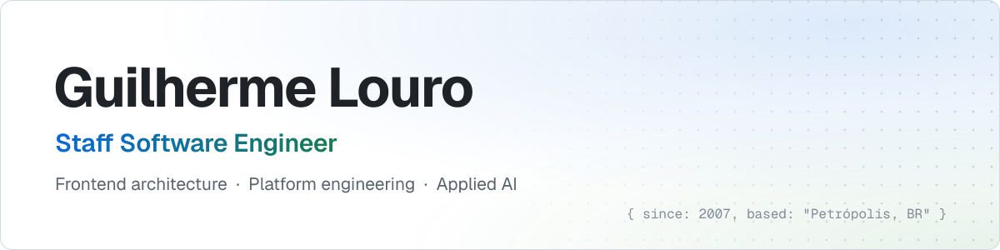
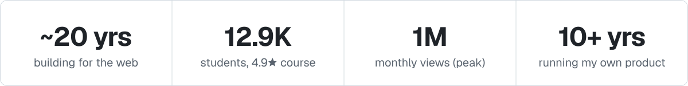
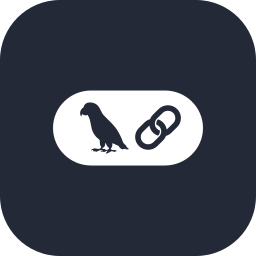

<picture>
  <source media="(prefers-color-scheme: dark)" srcset="assets/banner-dark.svg">
  
</picture>

<picture>
  <source media="(prefers-color-scheme: dark)" srcset="assets/stats-dark.svg">
  
</picture>

I design frontend architecture that lets many teams ship independently, and I still go deep on the code. Currently at [dLocal](https://dlocal.com), leading frontend for finance and payment operations platforms. Previously [Appcues](https://www.appcues.com), [Telnyx](https://telnyx.com), [Personare](https://www.personare.com.br) (Tech Lead) and B2W Digital.

## Selected work

<table>
  <tr>
    <td width="50%" valign="top">
      <b>🗞️ <a href="https://netfla.com.br">NETFLA News Engine</a></b> 
      Multi-agent AI newsroom in production. Agents match, write and fact-check stories behind deterministic guardrails. 
      <samp>Python · CrewAI · RabbitMQ · Postgres · AWS</samp>
    </td>
    <td width="50%" valign="top">
      <b>🧩 Personare frontend platform</b> 
      Split a shared Next.js app into independently deployable domain apps on a shared design system. Every team involved adopted it. 
      <samp>Next.js · Lerna · Storybook · Styled Components</samp>
    </td>
  </tr>
  <tr>
    <td width="50%" valign="top">
      <b>🎓 <a href="https://github.com/React-Avancado/boilerplate">React Avançado</a></b> 
      Co-created and architected a production-grade e-commerce course. 12.9K students, 4.9★, boilerplate with 470+★. 
      <samp>Next.js · Strapi · GraphQL · Cypress · CI/CD</samp>
    </td>
    <td width="50%" valign="top">
      <b>🚀 B2W Site Blindado</b> 
      Led the Django monolith to React/Redux SPA migration that became the reference for later migrations. 
      <samp>React · Redux · Python · Falcon</samp>
    </td>
  </tr>
</table>

## Stack

  <samp>frontend&nbsp;&nbsp;&nbsp;&nbsp;&nbsp;</samp>
  
  
  
  
  
  
  

  <samp>backend&nbsp;&nbsp;&nbsp;&nbsp;&nbsp;&nbsp;</samp>
  
  
  
  
  

  <samp>data&nbsp;&amp;&nbsp;infra&nbsp;</samp>
  
  
  
  
  
  
  
  

  <samp>testing&nbsp;&nbsp;&nbsp;&nbsp;&nbsp;&nbsp;</samp>
  
  
  
  

  <samp>ai&nbsp;&nbsp;&nbsp;&nbsp;&nbsp;&nbsp;&nbsp;&nbsp;&nbsp;&nbsp;&nbsp;</samp>
  
  
  
  
  

 

  
  
  
  

